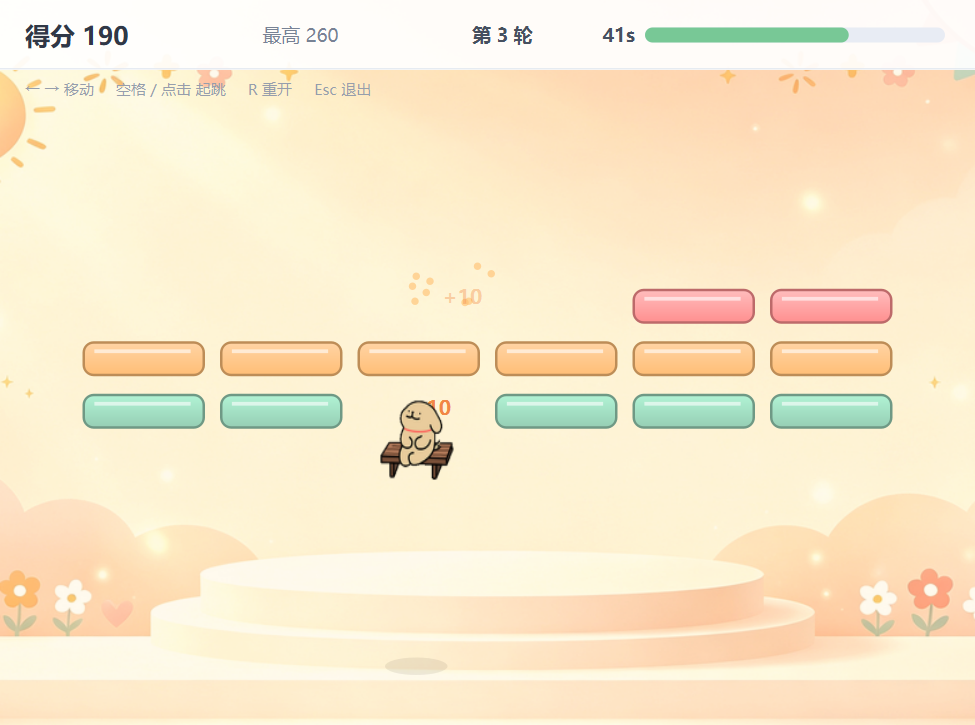
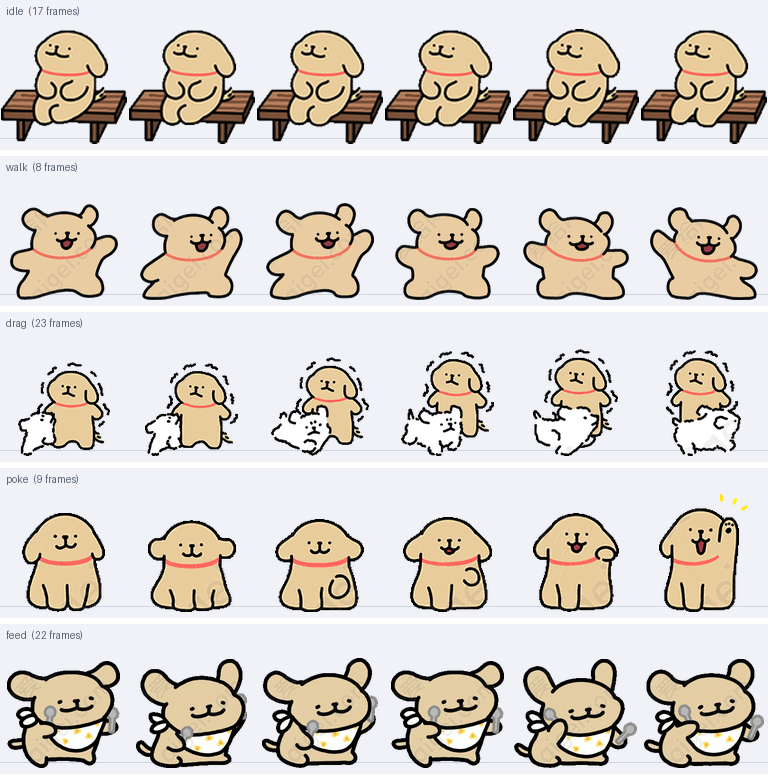

<div align="center">


# 小狗桌宠 · Desktop Pet

一只常驻桌面的**线条小狗**：会自己走动、发呆、坐长椅、困了就睡。
可以逗它、喂它、把它拎起来甩出去，它也会在你不理它的时候自己找事做。

Windows 10 / 11 · 自带 **4 个小游戏**和一本 **102 张**的收集卡册 · **不用装 Python，不用联网**

[](https://github.com/beichuanshengsi/desktop-pet-releases/releases/latest)
[](#安装三步)
[](https://github.com/beichuanshengsi/desktop-pet-releases/releases/latest)

### ⬇️ [**点这里下载最新版**](https://github.com/beichuanshengsi/desktop-pet-releases/releases/latest)

*打开页面 → 在 Assets 里点那个 `.exe` → 双击运行。具体的见下面[三步](#安装三步)。*

</div>



---

> ### 关于这个仓库
> 这里**只放安装包**，方便同学朋友直接下载。
> 源码不公开，所以仓库里没有代码，只有可运行的成品和这份说明。

## 有什么好玩的

| | |
|---|---|
| 🐶 **陪伴** | 桌面上打滚、漫步、坐长椅发呆、睡觉。犯困、饿了、心情不好都会有自己的表现 |
| 🖐 **互动** | 左键点它 = 逗它玩；按住拖 = 拎起来（甩出去它会被扔飞、还带弹性）；右键 = 打开菜单 |
| 🎮 **4 个小游戏** | 弹跳得分、接狗狗、跑一跑、狗粮 2048。玩完有金币 |
| 🃏 **收集卡册** | 抽卡得卡，一共 **102 张**：普通 51 / 稀有 26 / 史诗 18 / 传说 7。可以翻看卡册、只看已有的 |
| 🛒 **小卖部 + 背包** | 金币买肉干、玩具球、豪华大餐，放进背包，想用了再喂 |
| ⏱ **番茄钟** | 右键菜单里直接开番茄钟，时长可自定义；它会在旁边陪你 |
| 🧸 **幼儿模式** | 小朋友玩电脑时用 —— 锁住鼠标（或连 `Win` / `Alt+Tab` 一起锁），要退出得输密码 |
| 🎨 **换形象** | 把 128×128 的 PNG 丢进一个文件夹，就能换成你自己的图 |

**所有数据都在你自己电脑上，程序不联网，不上传任何东西。**

<details>
<summary>它一共有 <b>183 张</b>动作贴图，覆盖 6 类动作（点开看长什么样）</summary>

<br>



</details>

---

## ⬇️ 下载

去 **[Releases 页面](https://github.com/beichuanshengsi/desktop-pet-releases/releases/latest)**，
在 **Assets** 里点这个文件：

| 文件名 | 大小 | 适用 |
|---|---|---|
| `DesktopPet_v2.7.0_Setup.exe` | 约 49 MB | Windows 10 / 11（64 位） |

> 页面上的文件名会显示成中文「小狗桌宠_v2.7.0_安装包.exe」，实际下载下来的
> 文件名是上面那个 —— 是同一个文件，GitHub 只是不接受下载链接里带中文。

## 安装（三步）

### 第 1 步 · 双击下载好的 exe

### 第 2 步 · 一路点「下一步」

向导是**中文**的，一共就这几屏，不用做任何选择也能装好：

| 屏幕上写的 | 你要做的 |
|---|---|
| 欢迎使用 小狗桌宠 安装向导 | 点「下一步」 |
| 选择目标位置 | 不用改，直接「下一步」 |
| 选择附加任务 | 两个勾：**☑ 创建桌面快捷方式**（默认勾上）、**☐ 开机自动启动**（默认不勾，想要就自己勾） |
| 准备安装 | 点「安装」 |
| 小狗桌宠 安装完成 | 保持「**运行 小狗桌宠**」勾着，点「完成」—— 小狗就直接出来了 |

**全程不弹 UAC**（不请求管理员权限，不往系统盘乱写），装在你自己名下：

```
C:\Users\<你的用户名>\AppData\Local\Programs\小狗桌宠
```

### 第 3 步 · 第一次运行时 Windows 会拦一下

第一次运行很可能弹出**蓝色的**「**Windows 已保护你的电脑**」。这不是报毒，处理方法：

> 点「**更多信息**」→ 点「**仍要运行**」

为什么会有这个提示：程序**没有买代码签名证书**（个人项目一年几百块，不划算），
而 SmartScreen 对*所有*未签名程序都会这么拦一下。**安装完这一次之后就不会再出现了。**

想自己确认它安全，可以把 exe 上传到 [VirusTotal](https://www.virustotal.com/) 扫一遍。

---

## 装上之后

- **它会自己走**：不理它的时候它在桌面上漫步、发呆、坐长椅。困了自己睡，醒了继续晃。
- **右键它**有整个菜单：逗它玩 / 去睡一会儿 / 喂一口 / 卡册 / 小卖部 / 背包 / 番茄钟 / 一起玩游戏 / 幼儿模式，还有自动漫步、重力下坠、始终置顶这些开关。
- **想让它闭嘴安静待着**：右键 →「藏进托盘」。想叫回来，点任务栏右下角托盘里的小狗图标 →「显示」。**托盘是你唯一的"正规出口"**，它没有关闭按钮。
- **关掉 / 卸载**：见下面的「卸载」。

## 换成你自己的图

把 **128×128 的透明 PNG** 放进这个文件夹，按 `<状态>_<序号>.png` 命名就行：

```
C:\Users\<你的用户名>\AppData\Roaming\DesktopPet\custom_pet\
```

比如 `idle_00.png`、`walk_00.png`、`sleep_00.png`（状态有 `idle` `walk` `drag` `poke` `feed` `sleep`）。
**只要这个文件夹里有任何一张 png，内置形象就会被整体换掉**（不是叠加）。
想换回来，把里面的 png 删掉即可。

## 卸载

**设置 → 应用 → 已安装的应用**（Win10 是「控制面板 → 程序和功能」）→ 找到 **小狗桌宠** → 卸载。

卸载**不会**删掉你的存档和自定义形象（这是故意的，免得手滑丢进度）。

---

## 常见问题

<details>
<summary><b>装完了，但是看不到狗？</b></summary>

1. 先看**任务栏右下角的托盘区**（可能要展开小箭头），点小狗图标 →「显示」。
2. 它可能被拖到屏幕外面了 —— 托盘菜单里选「显示」会把它叫回可见区域。
3. 如果连托盘图标都没有，说明程序没起来，重启一次电脑试试。
</details>

<details>
<summary><b>杀毒软件/Windows Defender 报警了？</b></summary>

大概率是**误报**。这个 exe 是用 PyInstaller 打包的，打包器的特征码和某些恶意软件重叠，
所以未签名的 PyInstaller 程序经常被报毒，是这一行的老问题。

不放心的话把文件上传到 [VirusTotal](https://www.virustotal.com/) 看一眼：
通常是几十个引擎里只有一两个报，那就是典型误报特征。
</details>

<details>
<summary><b>换电脑了，进度（金币、卡册）能带走吗？</b></summary>

能。把整个 `%APPDATA%\DesktopPet\` 文件夹拷到新电脑的同一个位置就行。
（在文件资源管理器地址栏输入 `%APPDATA%` 回车就能到。）
</details>

<details>
<summary><b>它会占多少内存 / 吃 CPU 吗？</b></summary>

常驻内存实测**约 84 MB**；它在桌面上走路发呆时几乎不吃 CPU（只有动画重绘）。
一个后台挂着的浏览器标签页通常比它重。
</details>

<details>
<summary><b>会联网吗？会上传我的东西吗？</b></summary>

不会。整个程序**没有任何网络请求**，金币、卡册、状态全部存在本地一个 json 文件里。
断网装、断网玩都完全正常。
</details>

<details>
<summary><b>Mac / Linux 能用吗？</b></summary>

不能。只打了 **Windows 64 位**的包。程序本身是用 Qt 写的、理论上有跨平台的可能，
但这一版只针对 Windows 做和测过。
</details>

<details>
<summary><b>开机自动启动怎么开 / 怎么关？</b></summary>

装的时候那个「开机自动启动」的勾就是；装完之后想改，
在**任务管理器 → 启动应用**里把「小狗桌宠」启用/禁用即可。
</details>

---

## 更新记录

### v2.7.0 — 装备槽可以用高级碎片提前开一格

槽位原本**只按时间解锁**（第 1~3 周 1 格，之后每 3 周 +1），玩家这段时间无事可做、
也看不见进度。现在**时间解锁仍是主干**，碎片只是给不想等的人台阶：**40 个高级碎片换一格**。

> 为什么不是用金币买槽：金币是这套经济唯一的上游（单抽价就是专门用来抵消装备加成的刹车）。
> 让金币能买槽，立刻长出「买槽 → 加成 → 更多金币 → 更多槽」的正反馈环，
> 26 周的集齐时间线整个要重算。碎片是抽卡的下游副产品，买它不改变上游。

界面上按钮会提示剩余天数，避免「马上就要自然解锁了还白扔 40 碎片」。

### 更早的版本

v2.6 修了打砖块侧撞判定；v2.5 加卡册「仅看已有」和抽卡翻牌动画；
再往前是幼儿模式、番茄钟、卡册与抽卡、四个小游戏、装备槽。
（完整逐版记录随源码一起，暂不公开。）

## 这次发布前实跑的验证

- 自动化冒烟测试 **577 项全过，0 失败**
- 安装包**静默安装到干净目录** → 进程持续存活、存档正确写进 `%APPDATA%\DesktopPet\config.json` → **静默卸载零残留**
- 包内素材核对：**183 张贴图**（与源目录逐项一致）、**102 张卡池**、Qt 平台插件 `qwindows.dll` 齐全

---

<div align="center">
<sub>个人作品，免费分享给同学朋友玩。玩得开心 🐾</sub>
</div>
